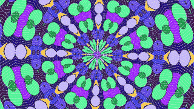
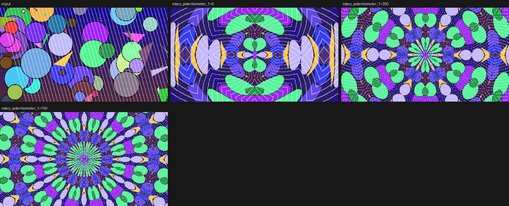
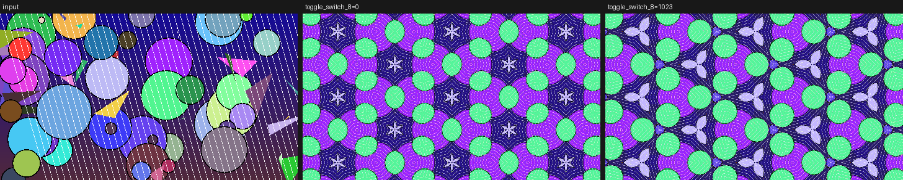
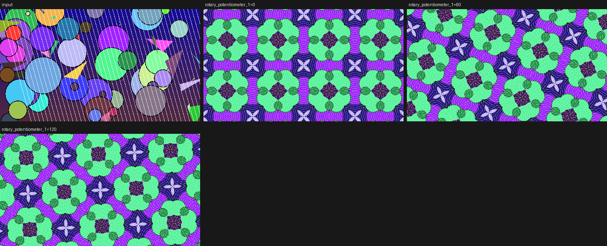

# videomancer-programs

FPGA video programs and tooling for the [LZX Industries Videomancer](https://lzxindustries.net/instruments/videomancer),
by cyberyak. Programs are VHDL for the iCE40 HX4K, built with the official
[Videomancer SDK](https://github.com/lzxindustries/videomancer-sdk).

## Programs

| Program | Status | What |
|---|---|---|
| [kaleido](programs/cyberyak/kaleido/) | v0.3: square, triangle, hex and radial, simulated; not yet tried on hardware | True 2-D kaleidoscope with square (p4m), triangle (*333) and hex (p6m) mirror groups and a radial mandala ([design](programs/cyberyak/kaleido/DESIGN.md)) |










### Path to the community library

`programs/cyberyak/<program>/` uses the same layout as
[videomancer-community-programs](https://github.com/lzxindustries/videomancer-community-programs).
When a program is ready to share, its folder is copied into a fork of that repo
under the same path and submitted as a pull request
([checklist](docs/upstreaming.md)).

## Layout

| Path | What |
|---|---|
| `programs/cyberyak/` | Our programs (`<name>.vhd`, `<name>.toml`, optional `model/`, `README.md`) |
| `tools/` | `env.sh` (toolchain), `vm_build.sh` (synth + resources), `vm_preview.py` (simulate → comparison sheet), `fastsim/` (Verilator simulator, ~1000× faster than GHDL) |
| `docs/` | Notes and plans, e.g. [fast simulation scope](docs/fast-sim-scope.md) (Jira: [VM-1](https://cyberyak.atlassian.net/browse/VM-1)) |
| `test-images/` | Simulation inputs |
| `videomancer-sdk/`, `videomancer-community-programs/` | Upstream repos as git submodules (read-only references) |
| `CLAUDE.md`, `.claude/` | Project memory, rules and skills for Claude Code |

## Setup (macOS, Apple Silicon)

```bash
git clone --recurse-submodules https://github.com/cyberyak/videomancer-programs.git
cd videomancer-programs
# OSS CAD Suite 2025-05-23 (GHDL, Yosys, nextpnr-ice40, Verilator, Python 3.11) into the SDK's build/
mkdir -p videomancer-sdk/build && cd videomancer-sdk/build
curl -L -o oss.tgz https://github.com/YosysHQ/oss-cad-suite-build/releases/download/2025-05-23/oss-cad-suite-darwin-arm64-20250523.tgz
tar -zxf oss.tgz && rm oss.tgz && cd ../..
source tools/env.sh && python3 -m pip install pillow numpy PyQt6
```

The path must not contain spaces, because the SDK's FPGA Makefile breaks on them.

## Everyday commands

```bash
source tools/env.sh
tools/vm_build.sh programs/cyberyak/<name> sd|hd|both        # ~35 s per config
python3 tools/vm_preview.py programs/cyberyak/<name> \
    --sweep rotary_potentiometer_1=0,512,1023                # fast engine: <1 s per frame
python3 tools/fastsim/fastsim.py simulate <program_dir> \
    --capture-frames 48 --output out.gif                     # animation
python3 tools/fastsim/compare.py <program_dir> ...           # check against GHDL
python3 tools/fastsim/live.py <program_dir>                  # live window: knobs, moving-circles source, ~30 fps
tools/vm_package.sh <program_dir>                            # unsigned .vmprog -> out/ (see docs/hardware-test.md)
python3 videomancer-sdk/tools/vhdl-image-tester/run.py       # SDK simulator GUI
```

Build artefacts go to `build/` (ignored). Signed `.vmprog` packages come from the
SDK's `build_programs.sh`, which needs Ed25519 keys (see the SDK's package-signing guide).

## Measured baselines (HD HDMI config)

| Program | Logic cells | EBR |
|---|---|---|
| passthru (≈ core overhead) | 1603 / 7680 | 0 / 32 |
| sabattier | 5545 | 0 |
| howler | 7070 | 15 |

nextpnr prints `Max frequency … FAIL at 74.25 MHz` on `ADV7611_CLK` **even for
passthru**. Treat it as baseline until LZX confirms otherwise.

## License

GPL-3.0-only, matching the Videomancer SDK and community programs. See [LICENSE](LICENSE).
