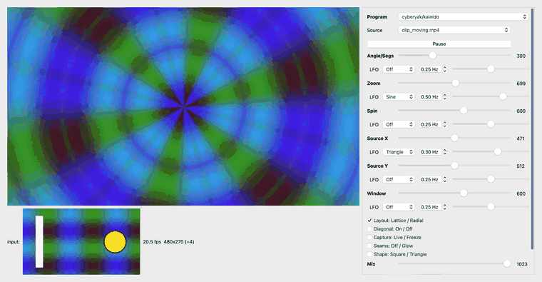
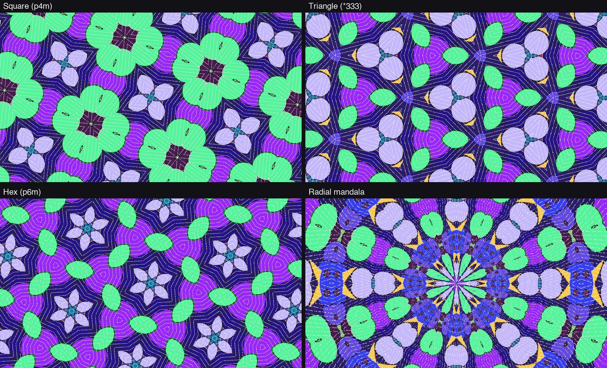
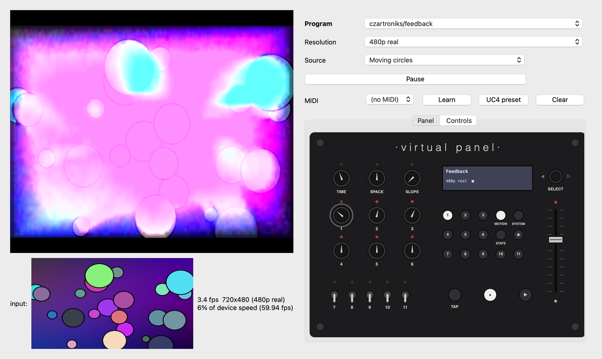

# videomancer-programs

FPGA video programs for the [LZX Industries Videomancer](https://lzxindustries.net/instruments/videomancer),
plus a fast Mac simulator for trying any Videomancer program without the hardware.

[](https://github.com/cyberyak/videomancer-programs/releases)
[](LICENSE)



*The live simulator running Kaleido's real VHDL on a moving clip. A radial mandala, with LFOs on Zoom and Source X.*

**[Download the latest release →](https://github.com/cyberyak/videomancer-programs/releases/latest)**

---

## Kaleido: a true 2-D kaleidoscope

Existing Videomancer mirror programs fold the picture side to side. Kaleido folds it in
**two dimensions**. Each frame it captures a window of the incoming video into a small
on-chip tile store and reads it back through a rotating, zooming coordinate, folded by a
mirror group.



| Mode | What you see | Switches |
|---|---|---|
| **Square** (p4m) | Square tiles mirrored on every edge and one diagonal | S7 Lattice, S11 Square |
| **Triangle** (*333) | The classic three-mirror toy kaleidoscope | S7 Lattice, S11 Triangle, S8 off |
| **Hex** (p6m) | Six-fold snowflake symmetry | S7 Lattice, S11 Triangle, S8 on |
| **Radial** | A mandala of 4–32 mirrored wedges and rings | S7 Radial, knob 1 = segments |

Spin, zoom, pan the capture window, freeze it, glow the seams, and crossfade with the
dry input. Full controls, install steps and limitations are in
**[Kaleido's README](programs/cyberyak/kaleido/README.md)**; how it works is in the
[design notes](programs/cyberyak/kaleido/DESIGN.md).

> **Status:** v0.3.0, a pre-release. Verified in simulation (bit-identical between Verilator
> and LZX's GHDL tester), not yet on a Videomancer. Hardware reports welcome.

---

## The live simulator

`tools/fastsim/live.py` runs a program's actual VHDL, compiled with
[Verilator](https://www.verilator.org), continuously at about **28 fps** (480×270 on an
Apple M2). That's roughly 1,000× faster than the SDK's GHDL image tester, so you can play
with a program the way you would on the device.



*Any program from the SDK or the [community library](https://github.com/lzxindustries/videomancer-community-programs).
Here czartroniks' Feedback runs on the moving-circles source.*

- **Program picker:** every program in the workspace. All 133 YUV-core programs build and run.
- **Resolution menu:**
  - Fast compact modes (÷4, ÷2).
  - **Real-timing** 480p, 720p and 1080p, with the standard's true resolution and blanking.
  - The 93 programs that size their graphics from the video standard open in 480p real automatically.
- **Controls:** knobs, switches and the fader, labelled from each program's TOML.
- **LFO per knob:** sine, triangle, saw, square or sample-and-hold, with a rate in Hz and
  a bipolar depth. It runs on the device's 59.94 Hz frame clock.
- **Sources:**
  - Moving circles
  - Still images
  - Video files, played frame-accurately on the device clock and looping
  - Any camera, including virtual cameras from VS2 or OBS
  - Syphon and NDI streams from other apps
- **Virtual front panel:** laid out like the Videomancer.
- **MIDI:** learn mode for any controller, plus a Faderfox UC4 preset.
- **Stable:** errors are logged to `build/live.log` instead of closing the window.

It simulates what the FPGA does clock by clock, so output matches the hardware logic,
not an approximation. Accuracy against LZX's GHDL reference is tracked in
[docs/fastsim-compat.md](docs/fastsim-compat.md).

---

## Quick start (macOS, Apple Silicon)

```bash
git clone --recurse-submodules https://github.com/cyberyak/videomancer-programs.git
cd videomancer-programs

# FPGA toolchain: OSS CAD Suite 2025-05-23 (GHDL, Yosys, nextpnr, Verilator, Python 3.11)
mkdir -p videomancer-sdk/build && cd videomancer-sdk/build
curl -L -o oss.tgz https://github.com/YosysHQ/oss-cad-suite-build/releases/download/2025-05-23/oss-cad-suite-darwin-arm64-20250523.tgz
tar -zxf oss.tgz && rm oss.tgz && cd ../..
source tools/env.sh && python3 -m pip install pillow numpy PyQt6 jsonschema opencv-python-headless mido python-rtmidi syphon-python cyndilib

# Open the live simulator
python3 tools/fastsim/live.py
```

The checkout path must not contain spaces, because the SDK's FPGA Makefile breaks on them.
Each program builds once, in about 4–10 s, and is cached after that.

## Everyday commands

```bash
source tools/env.sh
python3 tools/fastsim/live.py [program_dir] [--video F]      # live simulator
tools/vm_build.sh programs/cyberyak/<name> sd|hd|both        # synthesize, ~35 s per config
python3 tools/vm_preview.py <program_dir> \
    --sweep rotary_potentiometer_1=0,512,1023                # comparison sheet, <1 s per frame
python3 tools/fastsim/fastsim.py simulate <program_dir> \
    --capture-frames 48 --output out.gif                     # animation
python3 tools/fastsim/compare.py <program_dir> ...           # check against GHDL
python3 tools/fastsim/sweep.py                               # build + run every program
tools/vm_package.sh <program_dir>                            # unsigned .vmprog -> out/
tools/sim_gui.sh                                             # SDK GHDL tester window, with logging
```

## Repository layout

| Path | What |
|---|---|
| `programs/cyberyak/` | Our programs. Same layout as the community library, so they upstream by copying the folder ([checklist](docs/upstreaming.md)) |
| `tools/` | Build, preview and packaging scripts; `fastsim/` holds the Verilator simulator and live window |
| `docs/` | [Hardware test checklist](docs/hardware-test.md), [simulator scope](docs/fast-sim-scope.md), [compatibility](docs/fastsim-compat.md) |
| `test-images/` | Simulation inputs (images and a test clip) |
| `videomancer-sdk/`, `videomancer-community-programs/` | Upstream repos as git submodules (read-only) |
| `CLAUDE.md`, `.claude/` | Project memory, rules and skills for Claude Code |

## Hardware notes

| Program (HD HDMI) | Logic cells | Block RAM |
|---|---|---|
| passthru (≈ core overhead) | 1,603 / 7,680 | 0 / 32 |
| sabattier | 5,545 | 0 |
| howler | 7,070 | 15 |
| **kaleido v0.3** | **6,771** | **31** |

nextpnr prints `Max frequency … FAIL at 74.25 MHz` on `ADV7611_CLK` for every program,
including LZX's own passthru. Treat it as the baseline until confirmed on hardware.

## License

GPL-3.0-only, matching the Videomancer SDK and the community programs. See [LICENSE](LICENSE).
