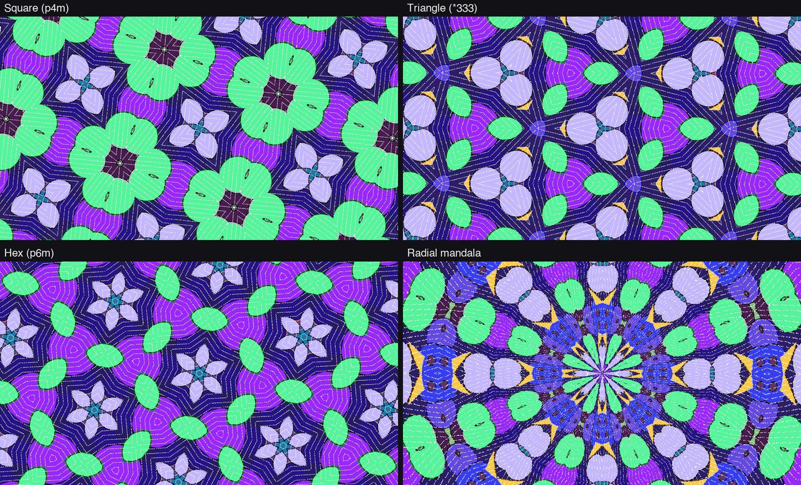
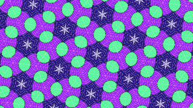
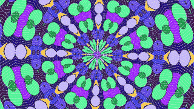

# Kaleido

A true two-dimensional kaleidoscope for the LZX Videomancer.



Videomancer has no frame buffer. Each frame, Kaleido captures a window of the incoming
video into a coarse on-chip tile store: 128×128 luma and 64×32 chroma, in 28 block RAMs.
Every output pixel then reads that store through a rotating, zooming coordinate folded by
a mirror group. A kaleidoscope shows one small region many times, so the coarse store
still fills the screen.

| Square, spinning | Hex, spinning | Radial mandala |
|---|---|---|
|  |  |  |

## Modes

| Mode | Symmetry | Switches |
|---|---|---|
| Square | p4m (pmm with Diagonal off) | S7 Lattice, S11 Square |
| Triangle | *333: the three-mirror toy kaleidoscope | S7 Lattice, S11 Triangle, S8 Diagonal off |
| Hex | *632 / p6m | S7 Lattice, S11 Triangle, S8 Diagonal on |
| Radial | D_n mandala, n = 2 to 16 (4 to 32 mirrored wedges) | S7 Radial; knob 1 sets n; S8 picks mirrored or repeated rings |

Radial reads the store in polar form, so each wedge shows the window **bent into a
sector** (a mandala), not an undistorted slice.

## Controls

| Control | Function |
|---|---|
| Knob 1: Angle / Segs | Static rotation. In radial mode: the segment count |
| Knob 2: Zoom | Tile or ring size (up = larger) |
| Knob 3: Spin | Rotation speed, bipolar (centre = still) |
| Knob 4: Source X | Pan the capture window horizontally |
| Knob 5: Source Y | Pan the capture window vertically |
| Knob 6: Window | Capture window size |
| S7 Layout | Lattice / Radial |
| S8 Diagonal | Extra mirror: square p4m vs pmm, triangle hex vs *333, radial mirrored vs repeated rings |
| S9 Capture | Live / Freeze (hold the tile, keep spinning) |
| S10 Seams | Off / Glow along the mirror lines |
| S11 Shape | Square / Triangle (Lattice layout) |
| Fader: Mix | Dry/wet crossfade |

Presets: Still Tiles, Slow Spin, Wallpaper, Hex, Toy Mirrors, Mandala.

## Install

1. Download `kaleido.vmprog` from the
   [latest release](https://github.com/cyberyak/videomancer-programs/releases/latest).
2. Copy it into `programs/` on the Videomancer's microSD card (FAT32), then power-cycle.
3. The package is unsigned, so you'll probably need **Developer Mode** to load it.

It contains bitstreams for all six inputs (SD/HD × HDMI/analog/dual); the firmware picks
the one that matches. Hardware test checklist: [docs/hardware-test.md](../../../docs/hardware-test.md).

## Resources and status

- **v0.3.0, pre-release.** All modes are bit-identical between fastsim and GHDL;
  not yet tested on hardware.
- **HD:** 6,771 / 7,680 logic cells and 31 / 32 block RAM. Latency 16 clocks.
- **Known limitations:**
  - Interlaced SD shows the pattern stretched 2:1.
  - Fast motion inside the window can tear (use Freeze).
  - nextpnr reports 51 MHz against the 74.25 MHz HD clock, the same reported FAIL as
    LZX's passthru; check this on hardware.

## Try it without hardware

```bash
source tools/env.sh
python3 tools/fastsim/live.py programs/cyberyak/kaleido --video test-images/clip_moving.mp4
```

Design and derivations, including the triangle-fold maps and the area savings that made
room for radial: [DESIGN.md](DESIGN.md).
